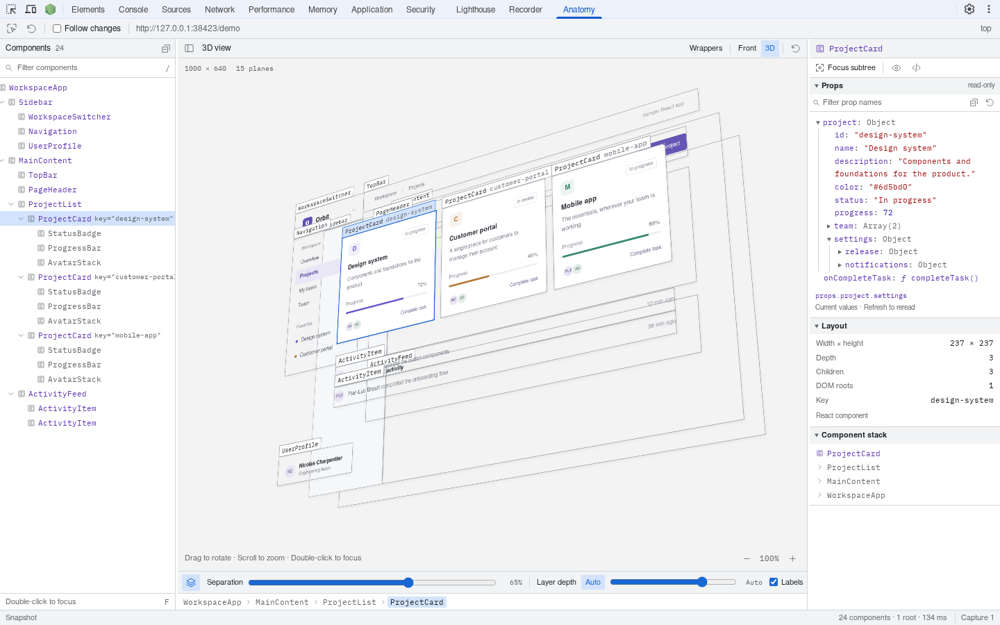

<picture>
  <source media="(prefers-color-scheme: dark)" srcset="packages/brand/svg/mark-dark.svg" />
  
</picture>

# React Anatomy

See how a React page is composed, in 3D, inside DevTools.

Explore the rendered component tree, pull the layout apart into layers, focus a subtree, and inspect live props. React Anatomy works with an already running React page, without code changes or a reload.



## Install

- [Chrome Web Store](https://chromewebstore.google.com/detail/react-anatomy/cllgnlljmehhoemdlfngkkpienkglkml) — also installs in Brave and Edge
- [Firefox Add-ons](https://addons.mozilla.org/en-US/firefox/addon/react-anatomy/)

Then open DevTools on a React page and choose **Anatomy**. Requires desktop Chrome or Firefox 140+ and React DOM 18.2, 18.3, or 19.0–19.3. You can also try the [interactive example](https://react-anatomy.com/#demo) on [react-anatomy.com](https://react-anatomy.com) without installing anything. [Documentation](https://react-anatomy.com/docs/)

## Run locally

Use Node **24.22.1** and the pinned **pnpm 12.16.1**:

```sh
corepack enable
pnpm install --frozen-lockfile
pnpm build:extension
```

Load `packages/extension/dist/extension` as an unpacked extension, then open **Anatomy** in DevTools. See the [extension guide](packages/extension/README.md) for Chrome and Firefox development builds.

To run the website and docs, use `pnpm dev`.

## Repository

| Package                                   | Contents                                            |
| ----------------------------------------- | --------------------------------------------------- |
| [extension](packages/extension/README.md) | Browser extension, capture engine, and 3D inspector |
| [website](packages/website/README.md)     | Astro landing page and Starlight documentation      |
| [brand](packages/brand/README.md)         | Exploded Stack logo and shared assets               |

[Development and testing](CONTRIBUTING.md) · [Compatibility](packages/website/src/content/docs/docs/compatibility.md) · [Privacy](packages/website/src/content/docs/privacy.md)

## License

[MIT](LICENSE). Bundled fonts and third-party assets retain their own licenses.
